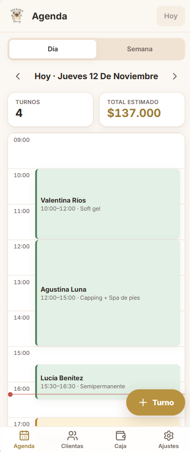
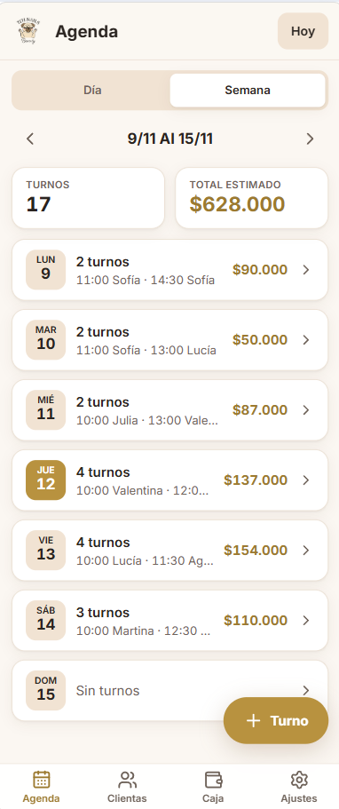
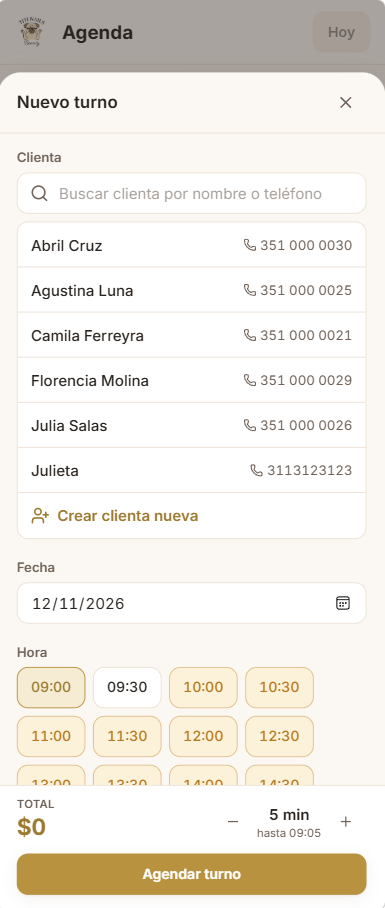
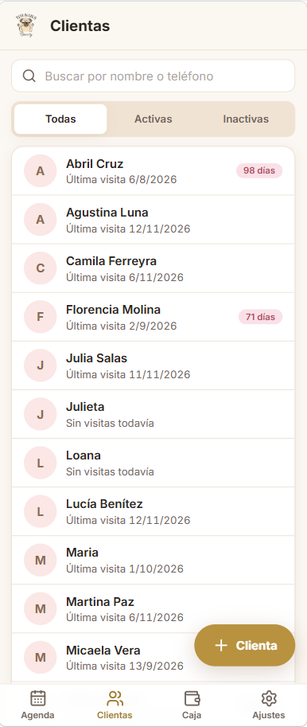
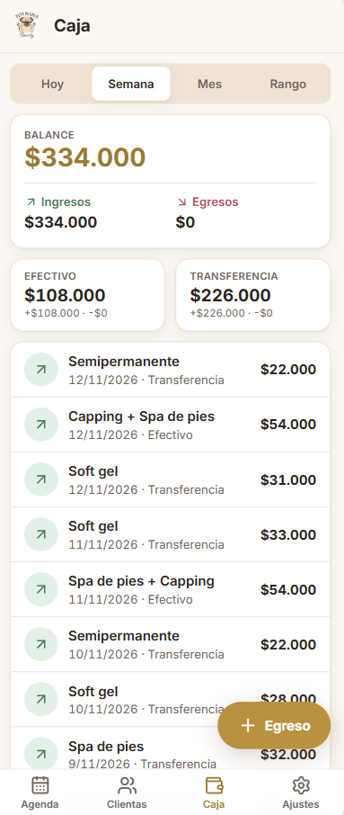
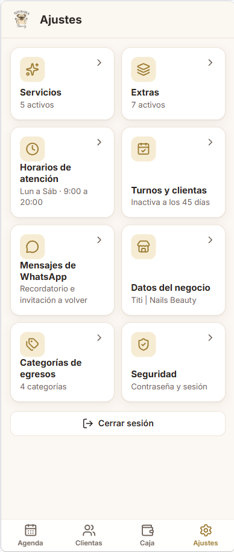

# Sistema de gestión para estética de uñas

Sistema web, pensado para usarse desde el celular, para administrar un negocio de estética de uñas. En uso real.

> Este repositorio es una **vitrina**: muestra qué hace el sistema y cómo está armado. El código fuente es privado.
> **¿Querés una demo para tu negocio?** [Pedila por mail](mailto:juan.avedano.contact@gmail.com?subject=Quiero%20una%20demo%20del%20sistema%20para%20est%C3%A9tica%20de%20u%C3%B1as).

## Qué resuelve

La dueña administra de forma autónoma turnos, clientas y caja, sin planillas ni cuadernos.

## Funcionalidades

- **Turnos**: agenda por día y por semana, con varios servicios por turno.
- **Alta de clientas** con teléfono y notas.
- **Servicios y extras**: catálogo con precios, duración y extras por uña o por mano.
- **Cierre de caja**: ingresos por efectivo y transferencia, egresos por categoría y balance.
- **Liquidación de sueldos**.
- **Recuperación de clientas inactivas**: detecta a quién hace tiempo que no viene y prepara el mensaje de WhatsApp.
- **Ajustes** del negocio: horarios de atención, plantillas de mensajes y seguridad.

## Capturas

| Agenda del día | Agenda semanal | Nuevo turno |
|---|---|---|
|  |  |  |

| Clientas | Caja | Ajustes |
|---|---|---|
|  |  |  |

*Capturas con datos de demostración ficticios.*

## Stack

**Backend:** FastAPI · SQLAlchemy · Alembic · PostgreSQL
**Frontend:** React · TypeScript · Tailwind CSS

## Contacto

**Juan Cruz Avedano** — Backend Developer (Python · FastAPI · React & TypeScript)
Córdoba, Argentina · [LinkedIn](https://www.linkedin.com/in/juan-cruz-avedano-165b90239/) · juan.avedano.contact@gmail.com
